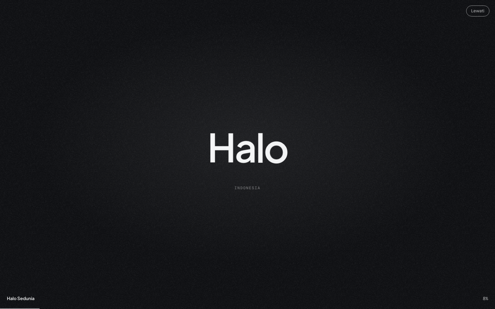
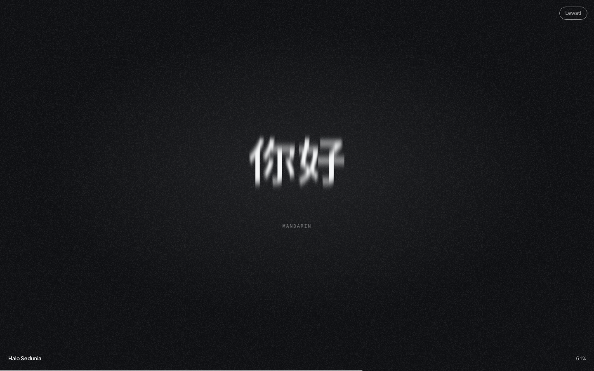
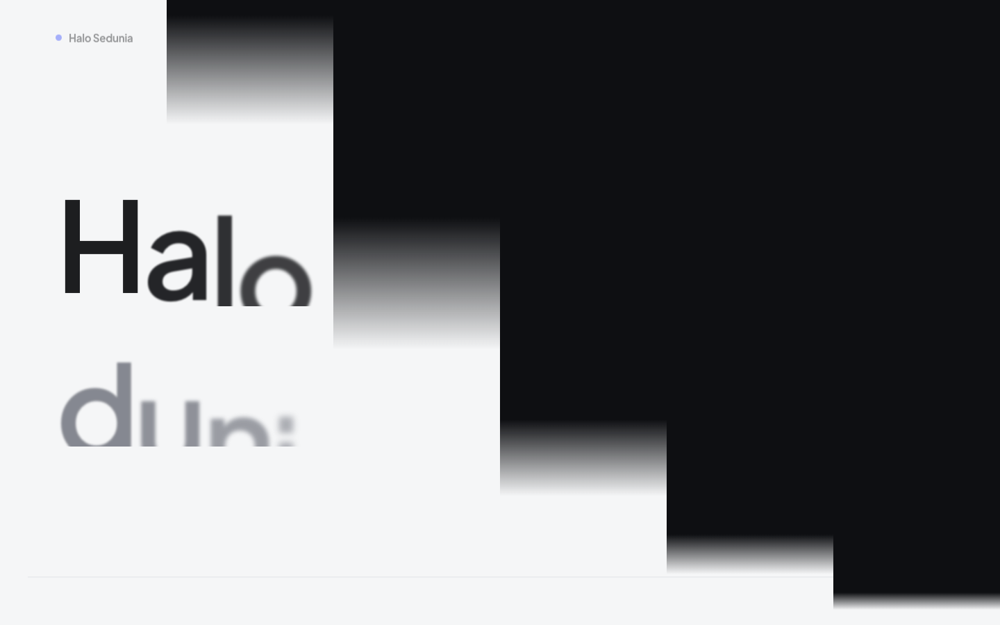
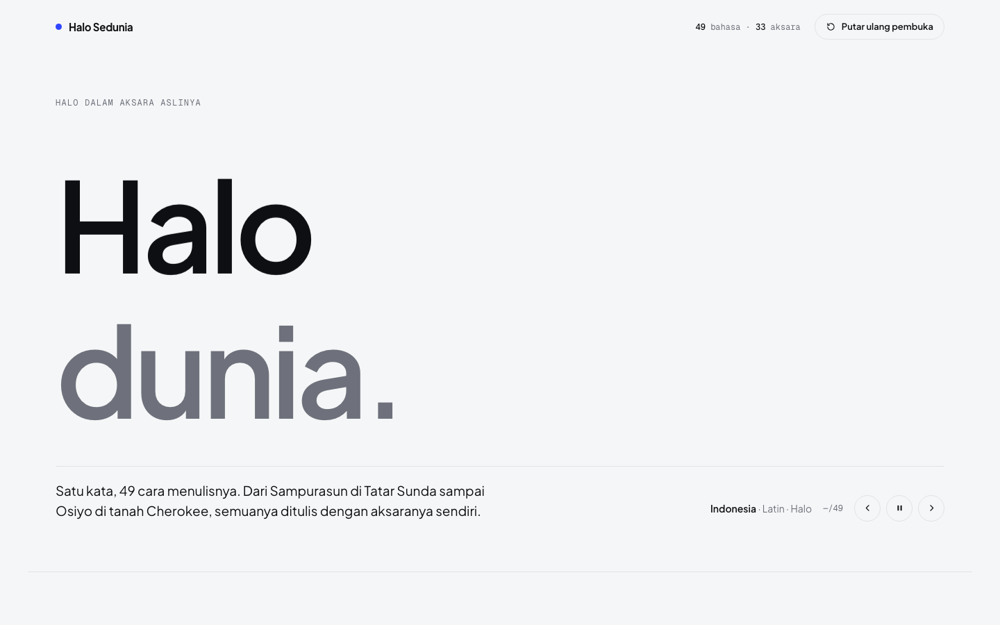
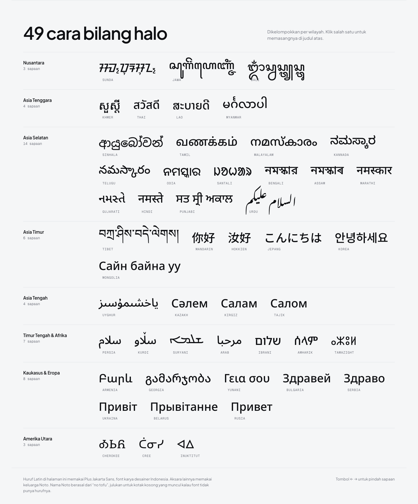
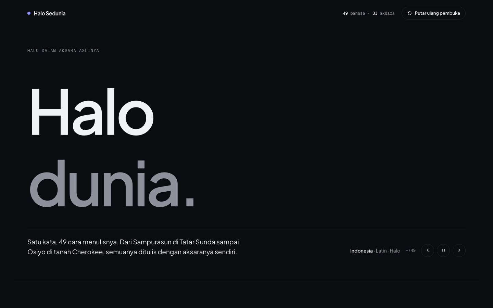
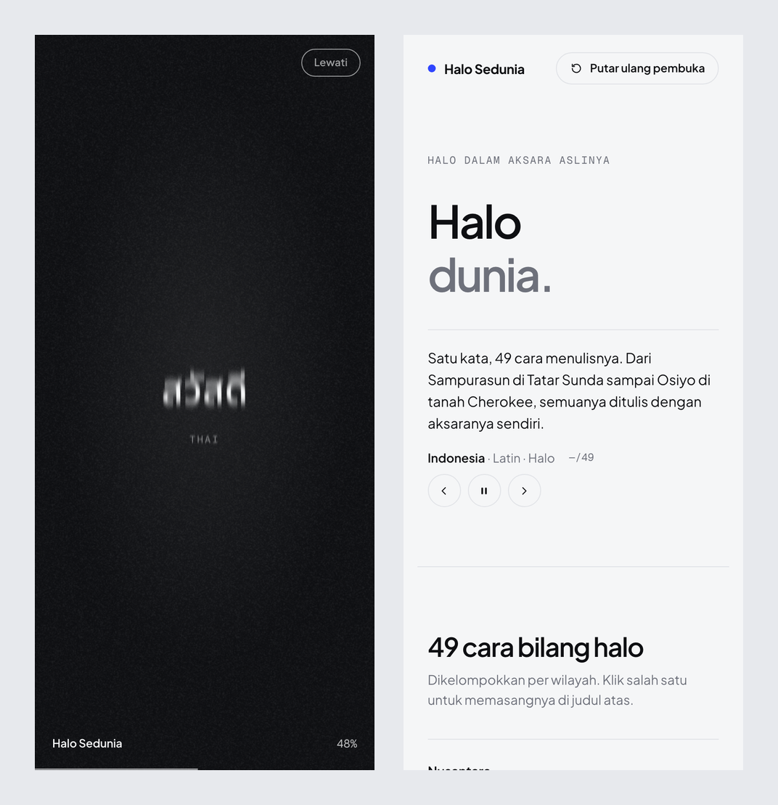

# Halo Sedunia

Website sederhana yang nampilin kata "halo" dari 49 bahasa. Semuanya ditulis pakai aksara aslinya masing-masing, mulai dari aksara Sunda, Jawa, dan Bali, terus Hangul, Hiragana, Arab, Dewanagari, sampai aksara Cherokee.

Pas website dibuka ada animasi pembuka dulu. Kata halonya ganti-ganti bahasa dengan cepat kayak opening video, habis itu layarnya kebuka ke halaman utama.

Websitenya statis, cuma pakai HTML, CSS, sama JavaScript biasa tanpa framework.

## Tampilan

**Animasi pembuka**



**Kata halo ganti-ganti bahasa**

Gantinya makin lama makin cepat, terus pelan lagi waktu mau berhenti. Tulisannya juga dikasih efek motion blur pas lagi bergerak.



**Transisi ke halaman utama**

Layar pembukanya kebagi jadi beberapa panel yang naik gantian dari kiri.



**Halaman utama**

Judulnya "Halo dunia." dan kata Halo-nya terus ganti ke bahasa lain tiap beberapa detik.



**Daftar sapaan**

Semua sapaan dikelompokin per wilayah. Kalau salah satu diklik, sapaannya langsung dipasang di judul atas.



**Mode gelap**

Warnanya otomatis ikut mode gelap atau terang di laptop/HP.



**Tampilan di HP**



## Fitur

- 49 sapaan dari 49 bahasa, pakai 33 aksara yang beda-beda.
- Animasi pembuka dengan efek motion blur. Bisa dilewati pakai tombol Lewati.
- Judul "Halo dunia." yang kata Halo-nya ganti bahasa sendiri. Bisa dijeda, atau dipindah pakai tombol panah dan tombol ← → di keyboard.
- Daftar sapaan per wilayah: Nusantara, Asia Tenggara, Asia Selatan, Asia Timur, Asia Tengah, Timur Tengah & Afrika, Kaukasus & Eropa, dan Amerika Utara.
- Ikut mode gelap/terang perangkat.
- Responsif, aman dibuka di HP.
- Kalau perangkat nyalain pengaturan "kurangi gerakan" (reduce motion), animasinya dibikin lebih kalem.

## Teknologi

- HTML, CSS, dan JavaScript biasa.
- Font Plus Jakarta Sans dan Geist Mono dari Google Fonts.
- Font keluarga Noto dari Google Fonts buat aksara-aksaranya, misalnya Noto Sans Sundanese, Noto Sans Javanese, Noto Sans JP, dan Noto Sans Arabic.

## Struktur folder

```text
.
├── index.html
├── assets
│   ├── css
│   │   └── style.css
│   └── js
│       └── script.js
└── screenshot
```

## Cara menjalankan

1. Clone atau download repo ini.
2. Buka file `index.html` di browser (Chrome, Firefox, Edge, atau Safari).
3. Pastikan konek internet, soalnya fontnya diambil dari Google Fonts. Kalau offline, beberapa aksara bisa muncul jadi kotak kosong.
4. Mau lihat animasi pembukanya lagi? Klik tombol "Putar ulang pembuka" di kanan atas.
